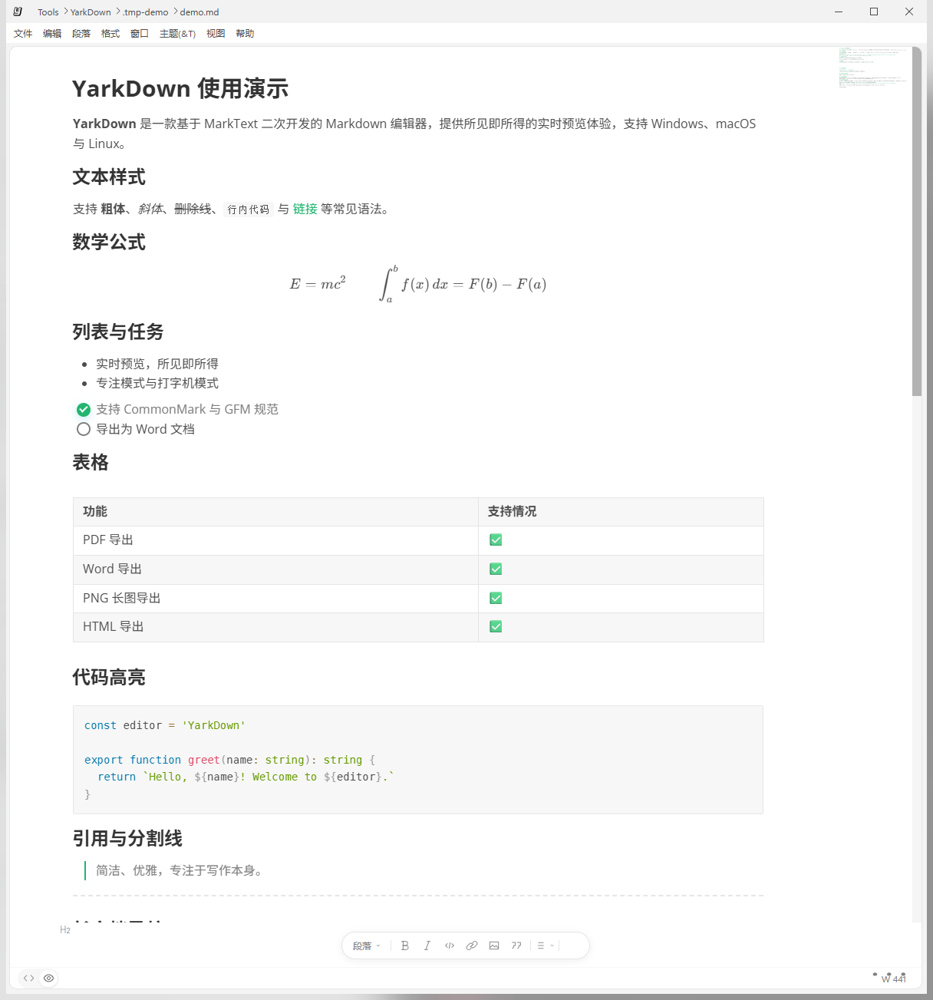
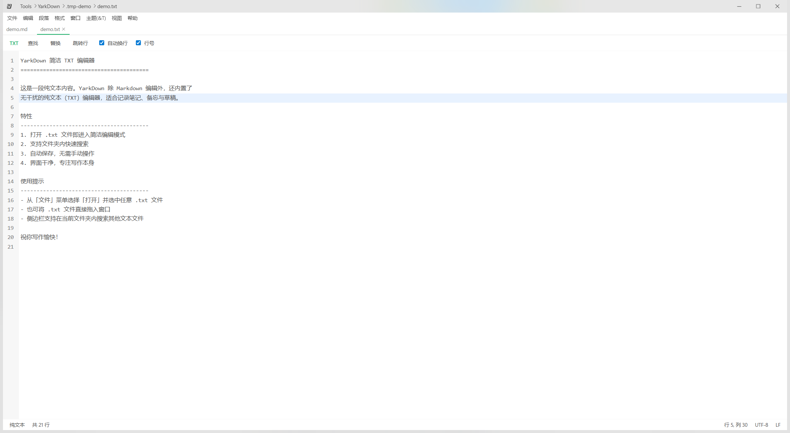

<p align="center"></p>

<h1 align="center">YarkDown</h1>

<div align="center">
  <strong>基于 MarkText 二次开发的 Markdown 编辑器，进一步定制功能、优化体验</strong><br>
  <sub>支持 Windows、macOS 与 Linux</sub>
</div>

<br>

<div align="center">
  <a href="LICENSE">MIT License</a>
  ·
  <a href="https://github.com/yumjasper/YarkDown/releases">下载发布版</a>
  ·
  <a href="https://github.com/yumjasper/YarkDown/issues">问题反馈</a>
</div>

<br>

## 简介

YarkDown 基于 [MarkText](https://github.com/marktext/marktext)（MIT 协议）的 v0.21.2 版本进行二次开发，在保留所见即所得实时预览编辑体验的基础上，进一步定制功能与优化表现：

- 全新的 Word 导出引擎，支持自适应页面尺寸，公式、图片与表格布局处理更加完善
- 内置简洁 TXT 纯文本编辑器，打开 `.txt` 文件即进入无干扰写作模式，支持查找、替换、行号与自动换行
- 全新应用图标与品牌设计，标题栏、任务栏、安装包统一为 YarkText 品牌形象
- Windows 标题栏半透明模糊效果，界面观感更现代
- 支持文件夹内快速搜索，方便在多文档之间切换
- 默认支持导出 PDF、HTML、无样式 HTML、PNG 长图与 Word 文档
- 编辑器侧边缩略图（minimap）：点击定位、拖动浏览，支持搜索匹配与光标标记
- 启动与渲染性能优化：延迟加载偏好页、Worker 绘制缩略图、大文件视口渲染

## 截图

### Markdown 编辑



实时预览文本样式、数学公式（KaTeX）、任务列表、表格与代码高亮。

### TXT 纯文本编辑



简洁的纯文本模式，顶部菜单提供查找、替换、跳转行、自动换行与行号开关，底部状态栏显示行列、编码与换行符，右侧支持缩略图快速定位。

## 历史版本功能

| 版本  | 主要内容                                                                                           |
| ----- | -------------------------------------------------------------------------------------------------- |
| 1.0.9 | 新增文档缩略图、菜单缩放控制、TXT 顶部菜单，优化启动与大文件渲染性能，接入 GitHub Actions 自动发布 |
| 1.0.8 | 重写 README 为 YarkDown 中文说明并合并远程仓库同步                                                 |
| 1.0.7 | 帮助界面全部链接切换为 YarkDown 仓库                                                               |
| 1.0.6 | 同步标题栏与全部展示 LOGO 为新图标设计                                                             |
| 1.0.5 | 新增简洁 TXT 编辑器并复用文件夹搜索                                                                |
| 1.0.4 | 图标源切换为 PNG 设计稿，完善公式导出稳定性；修复长文档导出 Word 时的公式截图错误                  |
| 1.0.3 | 重写 Word 导出引擎（docx 库），完善图片与表格布局处理                                              |
| 1.0.2 | 统一 YarkText 品牌，完善图片源码、公式排版、表格工具与多格式导出                                   |
| 1.0.1 | 统一软件名称为 YarkDown，同步三段版本号                                                            |
| 1.0.0 | 完善编辑器界面交互、快速测试与开发预览流程                                                         |

## 下载安装

安装包可从 [Releases](https://github.com/yumjasper/YarkDown/releases) 页面下载：

- Windows：`yarktext-win-(x64|arm64)-<版本号>-setup.exe`（安装版）或 `.zip`（免安装版）
- macOS：`yarktext-mac-(arm64|x64)-<版本号>.dmg`
- Linux：`yarktext-linux-<版本号>.AppImage` 等

## 开发

本仓库为 pnpm monorepo 结构，Node.js >= 20.19.0：

```bash
pnpm install   # 安装依赖
pnpm run dev   # 开发模式
pnpm run build:win  # 构建 Windows 安装包
```

更详细的开发说明见 [AGENTS.md](AGENTS.md)。

## 致谢

- [MarkText](https://github.com/marktext/marktext) — YarkDown 以其为基线二次开发
- 所有为本项目贡献过代码的朋友

## 许可证

[MIT](LICENSE) © yumjasper

YarkDown 基于 MarkText 二次开发，同样采用 MIT 开源协议。
